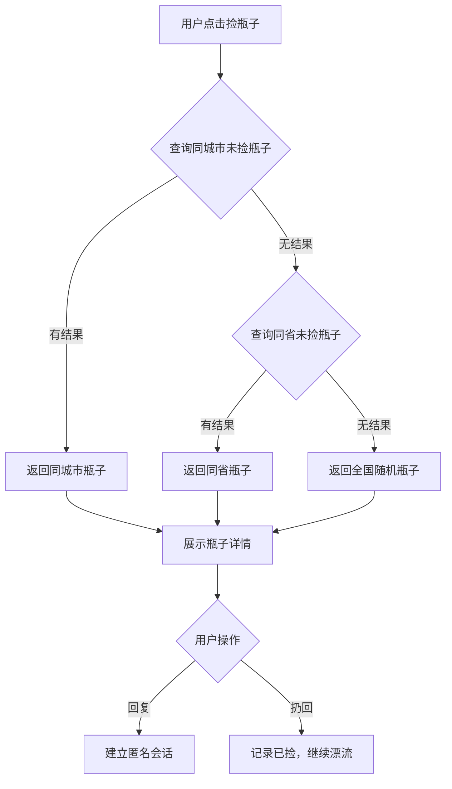

# 漂流瓶小程序产品需求文档

**版本：** v1.0  
**创建日期：** 2026-07-03  
**状态：** 待评审

---

## 1. 项目背景与目标

漂流瓶是一种轻匿名社交玩法：用户把文字、图片或语音装进“瓶子”扔进虚拟海洋，其他用户可以随机“捡到”并回复。产品面向年轻用户，强调偶然性、低压力社交和情绪表达。

本次需求聚焦 MVP 阶段，核心目标是验证用户是否愿意在低门槛匿名场景下产生互动。产品需要在微信小程序和 H5 双端运行，前期通过用户手动维护省市区地址完成同城匹配，降低技术复杂度和合规风险。

> **核心定位：** 轻匿名、同城优先、情绪向的异步社交小程序。

---

## 2. 目标用户与核心场景

### 2.1 用户画像

| 用户类型 | 特征 | 核心诉求 |
|---|---|---|
| 情绪倾诉型 | 18-28 岁，生活节奏快，社交压力较大 | 找一个不认识的树洞倾诉，不需要回应也行 |
| 好奇社交型 | 喜欢新鲜感，愿意和陌生人 low pressure 聊天 | 随机认识同城或同兴趣的人 |
| 内容创作者型 | 喜欢写短句、发语音、分享心情 | 获得陌生人的反馈和认同 |

### 2.2 核心场景

1. **扔瓶子：** 用户写下文字或录制语音，选择瓶子类型，投入海洋。
2. **捡瓶子：** 用户在首页随机捡到同城或同省的瓶子，阅读后可选择回复或扔回海里。
3. **回复私聊：** 捡到瓶子后，双方进入一对一匿名会话，可继续聊天。
4. **举报与拉黑：** 遇到骚扰、广告、违规内容，用户可举报或拉黑对方。

---

## 3. 功能需求总览

| 模块 | 功能点 | 优先级 | 说明 |
|---|---|---|---|
| 账号体系 | 微信一键登录、资料编辑、地址维护 | P0 | 用户手动选择省市区，作为同城匹配依据 |
| 首页 / 海洋 | 瓶子流展示、捡瓶子入口、我的瓶子入口 | P0 | 默认展示同城瓶子，支持一键打捞 |
| 扔瓶子 | 文字/图片/语音输入、瓶子类型、可见范围 | P0 | 内容需经服务端审核后才能被捡到 |
| 捡瓶子 | 随机匹配、瓶子详情、回复/扔回 | P0 | 按 city_code 优先，district_code 次之，支持已读过滤 |
| 消息会话 | 一对一匿名聊天、消息列表、未读提醒 | P0 | 双方基于 bottle_picked_record 建立会话 |
| 个人中心 | 我的瓶子、捡到的瓶子、设置、黑名单 | P1 | 展示历史记录和基础设置 |
| 举报与审核 | 举报瓶子/用户、人工审核、封号处理 | P1 | 保障内容安全，降低被封类目风险 |
| 运营后台 | 用户管理、内容审核、数据统计 | P2 | Web 管理后台，初期可简化 |

---

## 4. 功能模块详述

### 4.1 账号与资料

用户首次进入小程序时，通过微信 `wx.login` 获取 openid 完成静默登录。首次登录后引导完善基础资料：

- 昵称：2-20 个字符，支持中文、英文、数字，不允许纯符号。
- 头像：可选，从微信头像同步或本地上传。
- 地址：必填，通过省市区三级选择器手动选择，数据库存行政区划编码（adcode）。

> **地址修改限制：** 地址 7 天内仅允许修改 1 次，防止用户频繁切换城市刷瓶子。

### 4.2 首页 / 海洋

首页是用户进入后的主界面，包含三个核心区域：

- **顶部导航：** 当前城市名称 + 切换城市入口。
- **海洋动效区：** 背景为海面/沙滩动效，中央放置“捡一个瓶子”按钮。
- **底部 Tab：** 海洋（首页）、我的瓶子、消息、我的。

### 4.3 扔瓶子

点击首页“扔瓶子”进入编辑页，用户可创建以下类型瓶子：

| 瓶子类型 | 内容形式 | 可见范围 |
|---|---|---|
| 普通瓶 | 文字 + 最多 3 张图片 | 同城市 |
| 语音瓶 | 语音（最长 60 秒）+ 文字补充 | 同城市 |
| 秘密瓶 | 纯文字，24 小时后自动销毁 | 同省 |

瓶子创建后进入**待审核状态**，服务端完成内容安全审核后才可被其他用户捡到。审核失败向用户提示“内容未通过审核”，并允许修改后重投。

### 4.4 捡瓶子

用户点击“捡一个瓶子”，系统按以下规则匹配：

1. 优先匹配同 `city_code` 且未捡过的瓶子。
2. 同城市内，优先匹配同 `district_code`。
3. 同城市无结果时，扩大到同 `province_code`。
4. 同省无结果时，返回全国随机瓶子（兜底）。

匹配到的瓶子展示内容、类型标签、发布时间，用户可选择**回复**或**扔回海里**。扔回后该瓶子对该用户不再出现。

**图 1：捡瓶子匹配与交互流程**

### 4.5 消息会话

用户回复瓶子后，双方建立一对一匿名会话。会话特性：

- 双方在会话中均显示匿名昵称，不暴露真实微信信息。
- 支持文字、图片、语音消息。
- 任何一方可删除会话，删除后不再接收对方消息。
- 一方拉黑另一方后，双方会话关闭，且不能再通过瓶子互动。

### 4.6 举报与内容审核

每个瓶子和每条会话消息支持举报，举报原因包括：

- 色情低俗
- 广告诈骗
- 人身攻击
- 违法违规
- 其他

被举报内容进入人工审核队列，审核结果包括：通过、删除、封禁发布者。被封禁用户无法继续扔瓶子或回复。

---

## 5. 数据指标

| 指标类型 | 指标名称 | 定义 | 目标（MVP 阶段） |
|---|---|---|---|
| 核心指标 | 日活跃用户数（DAU） | 每日打开小程序的去重用户数 | [To be confirmed] |
| 核心指标 | 瓶子回复率 | 被捡到的瓶子中发生回复的比例 | > 15% |
| 过程指标 | 人均扔瓶数 | DAU / 每日新建瓶子数 | [To be confirmed] |
| 过程指标 | 人均捡瓶数 | DAU / 每日捡瓶子次数 | [To be confirmed] |
| 质量指标 | 举报率 | 举报内容数 / 总内容数 | < 1% |
| 质量指标 | 审核通过率 | 通过审核的内容数 / 提交审核的内容数 | > 90% |

---

## 6. 迭代计划

| 阶段 | 目标 | 功能范围 | 周期（预估） |
|---|---|---|---|
| MVP | 验证核心玩法 | 微信登录、资料地址、扔瓶、捡瓶、回复会话、举报 | 4-6 周 |
| V1.1 | 提升互动留存 | 瓶子类型扩展、未读推送、我的瓶子历史、黑名单 | 2-3 周 |
| V1.2 | 运营与变现探索 | 运营后台、虚拟礼物、会员特权、内容推荐 | 3-4 周 |
| V2.0 | 地理位置升级 | 可选 GPS 定位、附近的人、距离显示、地图展示 | 视数据决定 |

---

## 7. 风险与假设

> **关键假设（待验证）：**
> - 用户愿意手动选择城市并基于城市进行匿名社交。
> - 同城匹配能产生足够的回复动机。
> - 内容审核机制能将违规率控制在可接受范围。

> **主要风险：**
> - 合规风险：UGC + 匿名社交容易被投诉，需严格内容审核。
> - 冷启动风险：初期瓶子数量不足，用户捡不到瓶子会流失。
> - 女性用户体验风险：匿名场景下骚扰内容较多，需快速举报和封号机制。
