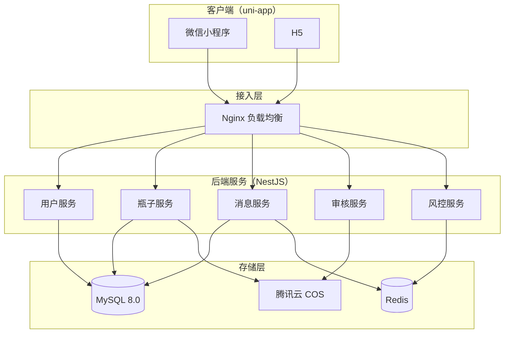
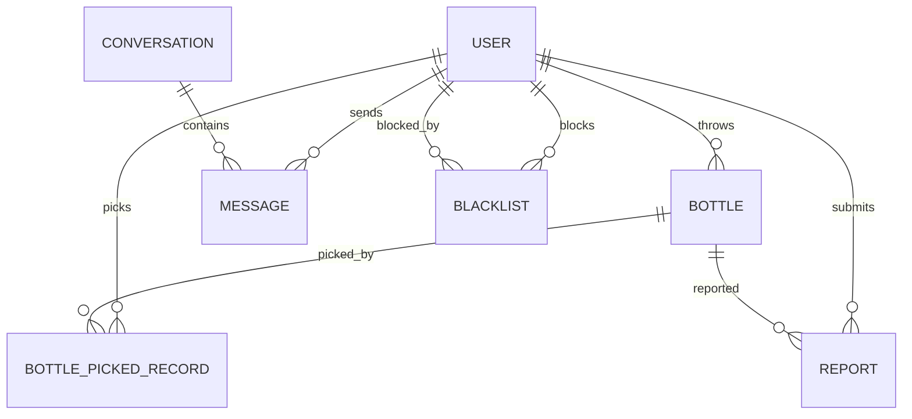

# 漂流瓶小程序技术开发文档

**版本：** v1.0  
**创建日期：** 2026-07-03  
**状态：** 待评审

---

## 1. 技术选型

本方案面向 MVP 阶段，优先选择团队熟悉、成本可控、部署简单的技术栈。所有选型均基于前期产品方案中“手动维护省市区地址、不做 GPS 实时定位”的约束。

| 层级 | 选型 | 说明 |
|---|---|---|
| 前端框架 | uni-app 3 + Vue3 + TypeScript | 一套代码编译到微信小程序和 H5，生态成熟，组件丰富 |
| 后端语言 | Node.js / TypeScript | 全栈统一语言，开发效率高，适合快速验证 |
| 后端框架 | NestJS | 模块化、可维护，内置依赖注入和拦截器 |
| 数据库 | MySQL 8.0 | 省市区匹配为普通关系查询，MySQL 完全胜任 |
| 缓存 | Redis | 会话未读数、限流、黑名单、热门数据缓存 |
| 对象存储 | 腾讯云 COS / 阿里云 OSS | 图片、语音文件存储，CDN 加速 |
| 实时通信 | WebSocket (Socket.io) | 一对一消息实时推送 |
| 内容审核 | 微信小程序内容安全 API + 敏感词库 | 文本、图片、语音审核，降低违规风险 |
| 部署 | Docker + 云服务器 | 容器化部署，便于扩展 |

---

## 2. 系统架构



**图 1：系统整体架构**

---

## 3. 数据库设计

### 3.1 实体关系



**图 2：核心实体关系**

### 3.2 核心表结构

#### 用户表 users

```sql
CREATE TABLE users (
  id BIGINT PRIMARY KEY AUTO_INCREMENT,
  openid VARCHAR(64) UNIQUE NOT NULL COMMENT '微信 openid',
  unionid VARCHAR(64) DEFAULT NULL COMMENT '微信 unionid',
  nickname VARCHAR(50) NOT NULL COMMENT '昵称',
  avatar_url VARCHAR(255) DEFAULT NULL COMMENT '头像 URL',
  province_code VARCHAR(20) NOT NULL COMMENT '省级编码',
  province_name VARCHAR(50) NOT NULL,
  city_code VARCHAR(20) NOT NULL COMMENT '市级编码',
  city_name VARCHAR(50) NOT NULL,
  district_code VARCHAR(20) DEFAULT NULL COMMENT '区县编码',
  district_name VARCHAR(50) DEFAULT NULL,
  status TINYINT DEFAULT 1 COMMENT '1正常 2禁言 3封号',
  address_updated_at TIMESTAMP DEFAULT CURRENT_TIMESTAMP,
  created_at TIMESTAMP DEFAULT CURRENT_TIMESTAMP,
  updated_at TIMESTAMP DEFAULT CURRENT_TIMESTAMP ON UPDATE CURRENT_TIMESTAMP,
  INDEX idx_openid (openid),
  INDEX idx_city_code (city_code),
  INDEX idx_status (status)
) ENGINE=InnoDB DEFAULT CHARSET=utf8mb4 COMMENT='用户表';
```

#### 瓶子表 bottles

```sql
CREATE TABLE bottles (
  id BIGINT PRIMARY KEY AUTO_INCREMENT,
  user_id BIGINT NOT NULL COMMENT '发布者',
  content TEXT COMMENT '文字内容',
  media_urls JSON DEFAULT NULL COMMENT '图片/语音 URL 数组',
  bottle_type TINYINT DEFAULT 1 COMMENT '1普通瓶 2语音瓶 3秘密瓶',
  province_code VARCHAR(20) NOT NULL,
  city_code VARCHAR(20) NOT NULL,
  district_code VARCHAR(20) DEFAULT NULL,
  status TINYINT DEFAULT 0 COMMENT '0待审核 1已通过 2未通过 3已删除',
  is_picked BOOLEAN DEFAULT FALSE COMMENT '是否已被捡过',
  picked_count INT DEFAULT 0 COMMENT '被捡次数',
  visible_scope TINYINT DEFAULT 1 COMMENT '1同城 2同省',
  expire_at TIMESTAMP NULL DEFAULT NULL COMMENT '秘密瓶过期时间',
  created_at TIMESTAMP DEFAULT CURRENT_TIMESTAMP,
  updated_at TIMESTAMP DEFAULT CURRENT_TIMESTAMP ON UPDATE CURRENT_TIMESTAMP,
  INDEX idx_user_id (user_id),
  INDEX idx_city_status (city_code, status),
  INDEX idx_district_status (district_code, status),
  INDEX idx_created_at (created_at),
  INDEX idx_expire_at (expire_at)
) ENGINE=InnoDB DEFAULT CHARSET=utf8mb4 COMMENT='瓶子表';
```

#### 捡瓶子记录表 bottle_picked_records

```sql
CREATE TABLE bottle_picked_records (
  id BIGINT PRIMARY KEY AUTO_INCREMENT,
  bottle_id BIGINT NOT NULL,
  user_id BIGINT NOT NULL COMMENT '捡瓶人',
  is_replied BOOLEAN DEFAULT FALSE COMMENT '是否回复',
  created_at TIMESTAMP DEFAULT CURRENT_TIMESTAMP,
  UNIQUE KEY uk_bottle_user (bottle_id, user_id),
  INDEX idx_user_id (user_id),
  INDEX idx_bottle_id (bottle_id)
) ENGINE=InnoDB DEFAULT CHARSET=utf8mb4 COMMENT='捡瓶子记录表';
```

#### 会话表 conversations

```sql
CREATE TABLE conversations (
  id BIGINT PRIMARY KEY AUTO_INCREMENT,
  bottle_id BIGINT NOT NULL,
  user_a_id BIGINT NOT NULL COMMENT '扔瓶人',
  user_b_id BIGINT NOT NULL COMMENT '捡瓶/回复人',
  last_message_id BIGINT DEFAULT NULL,
  last_message_at TIMESTAMP NULL DEFAULT NULL,
  is_closed BOOLEAN DEFAULT FALSE COMMENT '是否关闭',
  created_at TIMESTAMP DEFAULT CURRENT_TIMESTAMP,
  updated_at TIMESTAMP DEFAULT CURRENT_TIMESTAMP ON UPDATE CURRENT_TIMESTAMP,
  UNIQUE KEY uk_bottle_pair (bottle_id, user_a_id, user_b_id),
  INDEX idx_user_a (user_a_id),
  INDEX idx_user_b (user_b_id),
  INDEX idx_last_message_at (last_message_at)
) ENGINE=InnoDB DEFAULT CHARSET=utf8mb4 COMMENT='会话表';
```

#### 消息表 messages

```sql
CREATE TABLE messages (
  id BIGINT PRIMARY KEY AUTO_INCREMENT,
  conversation_id BIGINT NOT NULL,
  sender_id BIGINT NOT NULL,
  content TEXT COMMENT '文字内容',
  media_url VARCHAR(255) DEFAULT NULL COMMENT '图片/语音 URL',
  msg_type TINYINT DEFAULT 1 COMMENT '1文字 2图片 3语音',
  is_read BOOLEAN DEFAULT FALSE,
  created_at TIMESTAMP DEFAULT CURRENT_TIMESTAMP,
  INDEX idx_conversation_id (conversation_id),
  INDEX idx_sender_id (sender_id),
  INDEX idx_created_at (created_at)
) ENGINE=InnoDB DEFAULT CHARSET=utf8mb4 COMMENT='消息表';
```

#### 举报表 reports

```sql
CREATE TABLE reports (
  id BIGINT PRIMARY KEY AUTO_INCREMENT,
  reporter_id BIGINT NOT NULL COMMENT '举报人',
  target_user_id BIGINT NOT NULL COMMENT '被举报人',
  target_bottle_id BIGINT DEFAULT NULL,
  target_message_id BIGINT DEFAULT NULL,
  reason TINYINT NOT NULL COMMENT '1色情 2广告诈骗 3人身攻击 4违法违规 5其他',
  description VARCHAR(500) DEFAULT NULL,
  status TINYINT DEFAULT 0 COMMENT '0待处理 1已处理-通过 2已处理-删除 3已处理-封号',
  handled_by BIGINT DEFAULT NULL,
  handled_at TIMESTAMP NULL DEFAULT NULL,
  created_at TIMESTAMP DEFAULT CURRENT_TIMESTAMP,
  INDEX idx_reporter (reporter_id),
  INDEX idx_target_user (target_user_id),
  INDEX idx_status (status)
) ENGINE=InnoDB DEFAULT CHARSET=utf8mb4 COMMENT='举报表';
```

#### 黑名单表 blacklists

```sql
CREATE TABLE blacklists (
  id BIGINT PRIMARY KEY AUTO_INCREMENT,
  user_id BIGINT NOT NULL COMMENT '拉黑者',
  blocked_user_id BIGINT NOT NULL COMMENT '被拉黑者',
  created_at TIMESTAMP DEFAULT CURRENT_TIMESTAMP,
  UNIQUE KEY uk_user_blocked (user_id, blocked_user_id),
  INDEX idx_user_id (user_id)
) ENGINE=InnoDB DEFAULT CHARSET=utf8mb4 COMMENT='黑名单表';
```

---

## 4. 核心业务逻辑

### 4.1 扔瓶子流程

1. 用户填写内容并提交。
2. 后端校验内容长度、图片数量、用户状态。
3. 内容进入**待审核状态**，调用微信小程序内容安全 API 进行文本/图片/语音审核。
4. 审核通过：瓶子状态变为 `1`，可被其他用户捡到。
5. 审核未通过：状态变为 `2`，通知用户修改后重新提交。

### 4.2 捡瓶子匹配算法

```sql
-- 按优先级返回一个瓶子
SELECT * FROM bottles
WHERE status = 1
  AND is_picked = FALSE
  AND city_code = :userCityCode
  AND id NOT IN (
    SELECT bottle_id FROM bottle_picked_records WHERE user_id = :userId
  )
ORDER BY 
  CASE WHEN district_code = :userDistrictCode THEN 0 ELSE 1 END,
  picked_count ASC,
  created_at DESC
LIMIT 1;

-- 同城市无结果时扩大至同省
SELECT * FROM bottles
WHERE status = 1
  AND is_picked = FALSE
  AND province_code = :userProvinceCode
  AND city_code != :userCityCode
  AND id NOT IN (
    SELECT bottle_id FROM bottle_picked_records WHERE user_id = :userId
  )
ORDER BY created_at DESC
LIMIT 1;

-- 同省无结果时全国兜底
SELECT * FROM bottles
WHERE status = 1
  AND is_picked = FALSE
  AND province_code != :userProvinceCode
  AND id NOT IN (
    SELECT bottle_id FROM bottle_picked_records WHERE user_id = :userId
  )
ORDER BY created_at DESC
LIMIT 1;
```

### 4.3 回复与建会话

1. 用户点击回复，后端创建 `bottle_picked_records` 记录（若不存在）。
2. 检查是否已存在 `conversations` 记录，不存在则创建。
3. 发送第一条消息，更新会话 `last_message_at`。
4. 通过 WebSocket 向接收方推送新消息通知。

---

## 5. 接口设计

### 5.1 接口概览

| 接口 | 方法 | 说明 |
|---|---|---|
| `/api/auth/login` | POST | 微信静默登录，返回 token |
| `/api/users/profile` | GET/PUT | 获取/更新用户资料 |
| `/api/bottles` | POST | 创建瓶子 |
| `/api/bottles/pick` | POST | 捡一个瓶子 |
| `/api/bottles/:id` | GET | 获取瓶子详情 |
| `/api/bottles/:id/reply` | POST | 回复瓶子 |
| `/api/conversations` | GET | 获取会话列表 |
| `/api/conversations/:id/messages` | GET/POST | 获取/发送消息 |
| `/api/reports` | POST | 提交举报 |
| `/api/blacklists` | POST/DELETE | 拉黑/取消拉黑 |
| `/api/upload` | POST | 上传图片/语音文件，返回 COS URL |

### 5.2 关键接口示例

#### 创建瓶子

```http
POST /api/bottles
Content-Type: application/json

{
  "content": "今天心情不好，想找人聊聊",
  "mediaUrls": ["https://cos.xxx.com/voice/xxx.mp3"],
  "bottleType": 1,
  "visibleScope": 1
}
```

```json
{
  "code": 0,
  "data": {
    "id": 10001,
    "status": 0,
    "message": "瓶子已投入海中，审核通过后即可被捡到"
  }
}
```

#### 捡瓶子

```http
POST /api/bottles/pick
```

```json
{
  "code": 0,
  "data": {
    "id": 10002,
    "content": "有没有人和我一样喜欢深夜听歌",
    "bottleType": 1,
    "cityName": "上海市",
    "createdAt": "2026-07-03T14:22:00Z",
    "canReply": true
  }
}
```

---

## 6. 安全与风控

### 6.1 内容安全

- 所有 UGC 内容必须经过微信小程序内容安全 API 审核。
- 文本内容增加敏感词库二次过滤。
- 图片、语音先调审核接口，通过后再入库。
- 被多次举报的内容自动进入人工复核队列。

### 6.2 反作弊与限流

| 场景 | 限制规则 | 实现方式 |
|---|---|---|
| 扔瓶子 | 同一用户每分钟最多 3 次，每天最多 30 次 | Redis 滑动窗口限流 |
| 捡瓶子 | 同一用户每分钟最多 10 次 | Redis 计数限流 |
| 修改地址 | 7 天内仅 1 次 | 数据库时间戳校验 |
| 发送消息 | 同一会话每秒最多 1 条，每天最多 200 条 | Redis + 数据库联合限流 |
| 举报 | 同一用户每天最多 20 次 | Redis 计数限流 |

### 6.3 隐私保护

- 前端不暴露用户 openid、真实微信信息。
- 瓶子详情不展示发布者真实昵称，使用匿名化展示。
- 不存储用户精确 GPS，仅存储用户手动选择的省市区。
- 图片、语音上传后做敏感信息扫描。

---

## 7. 部署方案

### 7.1 服务器资源（MVP 阶段）

| 服务 | 配置 | 数量 |
|---|---|---|
| NestJS 应用服务 | 2 核 4G | 1-2 台 |
| MySQL | 2 核 4G，SSD 100G | 1 台（可上云 RDS） |
| Redis | 1 核 2G | 1 台 |
| Nginx | 1 核 2G | 1 台 |

### 7.2 部署流程

1. 代码提交至 Git 仓库，触发 CI/CD 流水线。
2. 构建 Docker 镜像并推送至镜像仓库。
3. 服务器拉取镜像，使用 Docker Compose 或 Kubernetes 部署。
4. Nginx 配置反向代理、SSL、静态资源缓存。
5. 数据库变更通过 Flyway / TypeORM 迁移脚本执行。

### 7.3 监控与日志

- 应用日志：统一收集到日志服务，保留 30 天。
- 接口监控：监控 QPS、错误率、平均响应时间。
- 业务监控：核心指标如扔瓶数、捡瓶数、回复率实时看板。
- 告警：错误率 > 1% 或 P95 响应时间 > 1s 时触发告警。

---

## 8. 待确认事项

> - 小程序类目与资质：社交类目是否需要相关许可证？
> - 内容审核策略：是否全部采用机审，还是机审 + 人工复核？
> - 消息推送：是否接入微信小程序订阅消息提醒新回复？
> - 变现模式：是否预留虚拟礼物、会员体系接口？
